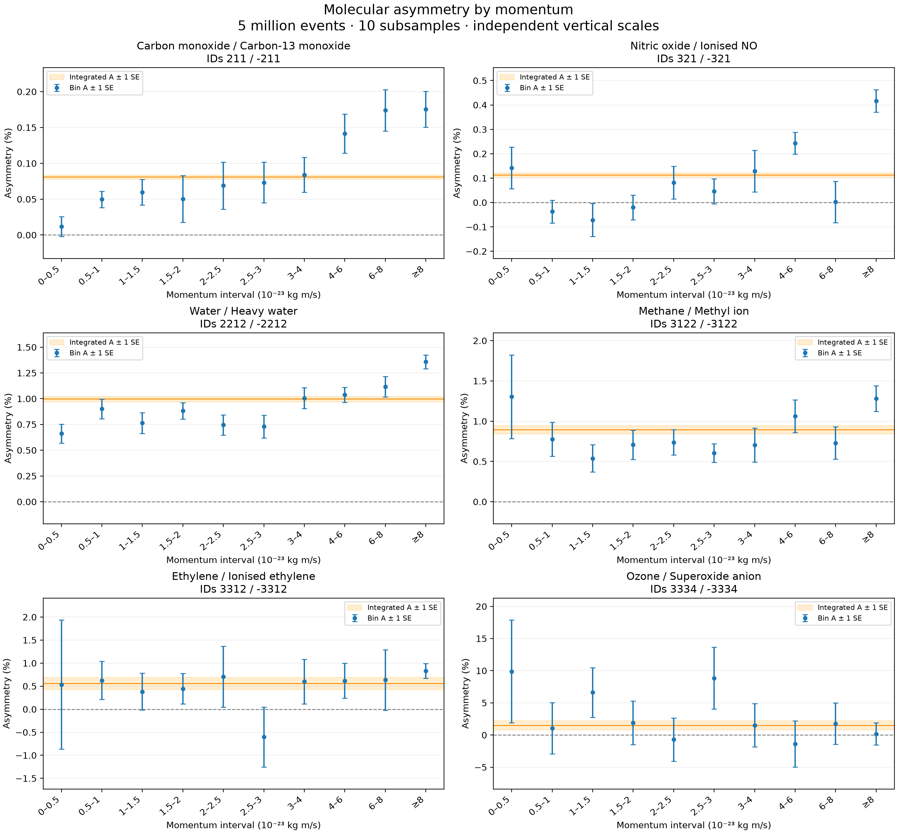
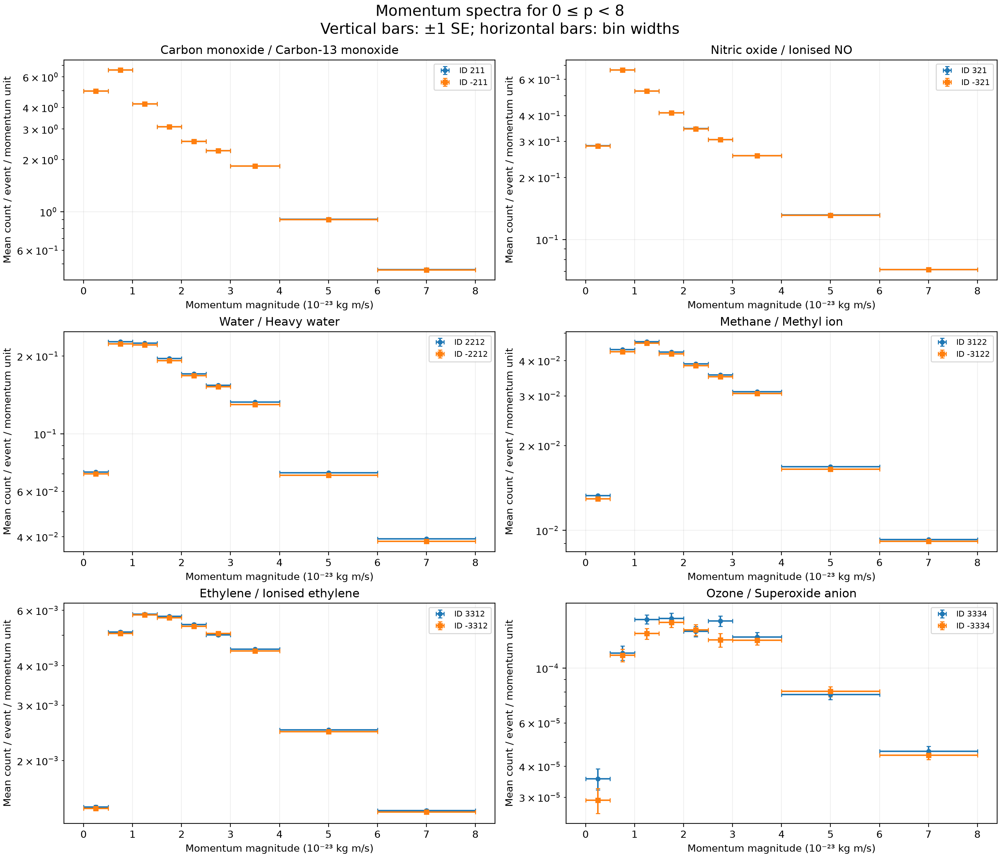

# PRA2003 — Molecular asymmetry analysis

**Author:** Marie Piekarek  
**Final deliverable: part 2**

## 1. Aim

Analyse all five million events, select the twelve course species,
calculate their mean counts per event and integrated asymmetries,
and plot asymmetry against momentum with statistical uncertainties.

The species names follow the course table. Positive and negative IDs
identify paired species; they do not necessarily represent electric charge.

## 2. Dataset

| Quantity | Value |
|---|---:|
| Input files | 10 |
| Events analysed | 5,000,000 |
| Empty events retained | 382,007 |
| Molecule rows read | 248,724,681 |
| Selected molecule rows | 221,204,606 |
| Subsamples | 10 |
| Events per subsample | 500,000 |

The input files are `output-Set1.txt` through `output-Set10.txt`.

Each event contains a header with its ID and molecule count, followed
by rows containing `px py pz molecule_ID`.

All events, including empty events and events without a selected
species, remain in the denominator for mean counts per event.

## 3. Statistical method

### Mean counts

For each species:

`Mean count per event = total species count / total events`

Complete events are assigned round-robin to ten equal subsamples.
All molecules belonging to an event stay together.

For ten subsample estimates x_j:

`SD = sqrt(sum((x_j - average(x_j))²) / (K - 1))`

`SE = SD / sqrt(K)`

SD measures the variation between subsample estimates.
SE estimates the statistical uncertainty on the full-sample result.

Both quantities are reported because the course notes refer to
subsample SD. **The plotted error bars and the ± uncertainties
discussed here use full-sample SE.**

### Paired asymmetry

`A = (N_positive - N_negative) / (N_positive + N_negative)`

The central result uses counts pooled over all events.
It is not an average of individual-event ratios.

The asymmetry is also calculated separately within each subsample.
Its uncertainty is estimated as the SD of these ten asymmetries
divided by sqrt(10). This retains correlations between members of
the pair and is an approximate uncertainty for the pooled ratio.

- Positive A: more positive-ID molecules.
- Negative A: more negative-ID molecules.
- A = 0: equal counts.

An asymmetry of 1% means a 50.5% versus 49.5% split of the pair total.

### Sigma screening rule

`Z = A / SE(A)`

The screening rule used here is `abs(Z) > 3`.
Sigma refers to the full-sample SE.

These scores are approximate standardized departures from zero,
not exact Gaussian significances or p-values.
Only ten subsamples are used, and no multiple-testing correction
is applied.

A second calculation treats each input file as one subsample.
This checks sensitivity to the partition; it does not automatically
correct for differences in simulation conditions.

## 4. Mean molecules per event

| ID | Species | Total | Mean/event | SD | SE |
| --- | --- | --- | --- | --- | --- |
| 211 | Carbon monoxide | 92,126,688 | 18.4253376 | 0.0254289 | 0.00804134 |
| -211 | Carbon-13 monoxide | 91,977,542 | 18.3955084 | 0.0268866 | 0.00850228 |
| 321 | Nitric oxide | 11,587,227 | 2.3174454 | 0.00360283 | 0.00113932 |
| -321 | Ionised NO | 11,560,946 | 2.3121892 | 0.00361557 | 0.00114334 |
| 2212 | Water | 5,578,693 | 1.1157386 | 0.00177532 | 0.000561407 |
| -2212 | Heavy water | 5,468,447 | 1.0936894 | 0.00165705 | 0.000524004 |
| 3122 | Methane | 1,277,330 | 0.2554660 | 0.000655563 | 0.000207307 |
| -3122 | Methyl ion | 1,254,690 | 0.2509380 | 0.000591683 | 0.000187107 |
| 3312 | Ethylene | 182,139 | 0.0364278 | 0.000231318 | 7.31491e-05 |
| -3312 | Ionised ethylene | 180,104 | 0.0360208 | 0.000391226 | 0.000123717 |
| 3334 | Ozone | 5,482 | 0.0010964 | 3.54877e-05 | 1.12222e-05 |
| -3334 | Superoxide anion | 5,318 | 0.0010636 | 3.87447e-05 | 1.22522e-05 |

## 5. Integrated asymmetries

These results include all momenta.

| Pair | A (%) | SE (percentage points) | SD (percentage points) | Approx. Z | A/SD | File-partition Z |
| --- | --- | --- | --- | --- | --- | --- |
| 211 / -211 | 0.08101 | 0.00282 | 0.00891 | 28.75 | 9.09 | 22.64 |
| 321 / -321 | 0.11353 | 0.00937 | 0.02962 | 12.12 | 3.83 | 5.46 |
| 2212 / -2212 | 0.99796 | 0.02654 | 0.08394 | 37.60 | 11.89 | 31.70 |
| 3122 / -3122 | 0.89415 | 0.05224 | 0.16520 | 17.12 | 5.41 | 26.66 |
| 3312 / -3312 | 0.56178 | 0.13206 | 0.41761 | 4.25 | 1.35 | 2.85 |
| 3334 / -3334 | 1.51852 | 0.71067 | 2.24734 | 2.14 | 0.68 | 1.64 |

The A/SD column is also provided for comparison with the literal
subsample-SD convention in the course notes. It must not be confused
with A/SE.

### Do we see molecular asymmetry?

Pairs passing the approximate three-SE threshold under both
partitions: **211/-211, 321/-321, 2212/-2212, 3122/-3122**.

Pairs whose threshold classification changes with the partition:
**3312/-3312**.

Pairs not exceeding the threshold under either partition:
**3334/-3334**.

Failure to exceed a threshold is not proof that the true asymmetry
is exactly zero. These statements describe statistical evidence
within the supplied simulation, not a demonstrated physical cause.

## 6. Asymmetry as a function of momentum

For every selected molecule:

`p = sqrt(px² + py² + pz²)`

Momentum is expressed in units of 10^-23 kg m/s.

The bin edges are:

`0, 0.5, 1, 1.5, 2, 2.5, 3, 4, 6, 8, infinity`

Each finite bin includes its lower edge and excludes its upper edge.
The last bin contains all p ≥ 8.

Within each bin, the pooled asymmetry and its subsampling uncertainty
are calculated using the same procedure as for the integrated result.

**Figure 1.** Blue points show binned asymmetries with ±1 SE error bars.
The orange band shows the integrated asymmetry ±1 SE.
The dashed line indicates zero asymmetry.

The horizontal axis shows ordered momentum intervals, not an equally
spaced numerical momentum scale. The final point represents an
open-ended interval. Each panel has its own vertical scale.

The integrated band and bin estimates share observations and are
correlated. Their overlap is not an independent statistical test.
A nonzero bin asymmetry alone does not demonstrate momentum dependence.

All numerical bin results are saved in `momentum_asymmetry.csv`.
Undefined subsample ratios are reported as NaN instead of zero.

## 7. Supporting momentum spectra

**Figure 2.** Mean counts per event per unit momentum.
Vertical error bars show ±1 SE; horizontal bars show bin widths.
The vertical axis is logarithmic.

The open-ended ≥8 bin is excluded only from this density plot because
it has no finite width. It remains included in the asymmetry plot and
integrated results.

Overlapping spectra can still have a measurable asymmetry:
the relative differences may be small compared with the total counts.

## 8. Input-file momentum comparison

| File | Selected molecules | Fraction with p ≥ 8 (%) |
| --- | --- | --- |
| output-Set1.txt | 22,185,521 | 13.6763 |
| output-Set2.txt | 22,128,362 | 13.6193 |
| output-Set3.txt | 22,095,077 | 13.6418 |
| output-Set4.txt | 22,137,599 | 13.6540 |
| output-Set5.txt | 22,088,010 | 13.6374 |
| output-Set6.txt | 22,098,163 | 13.6521 |
| output-Set7.txt | 22,099,450 | 13.6394 |
| output-Set8.txt | 22,135,307 | 13.6443 |
| output-Set9.txt | 22,083,471 | 13.6523 |
| output-Set10.txt | 22,153,646 | 0.0245 |

The supplied data show a substantially smaller fraction of selected
molecules with p ≥ 8 in file 10 than in files 1–9.
The cause is not established from the supplied information.

All ten files are retained. Their momentum distributions should not
be assumed identical without checking the simulation settings and
units. Round-robin subsamples mix files, so the primary error bars
describe sampling variation of this particular combined dataset;
they do not account for an unknown difference in generation conditions.

Consequently, an interpretation of momentum trends as a physical
effect remains provisional. The file-partition comparison is a
sensitivity diagnostic, not a complete correction.

## 9. Limitations

- Subsampling uncertainties rely on suitable independence assumptions.
- Only ten subsamples are available, so uncertainty estimates fluctuate.
- The pooled asymmetry is a nonlinear ratio; its SE is approximate.
- Rare species have less precise estimates.
- Six pairs and multiple bins are examined without a multiple-testing
  correction.
- No exact Gaussian discovery significance is claimed.
- Systematic effects are not estimated.
- A formal test of a momentum trend is not performed here.
- The input-file momentum difference requires clarification.

## 10. Conclusion

The combined dataset provides evidence of integrated molecular
asymmetry for **211/-211, 321/-321, 2212/-2212, 3122/-3122**, with the approximate three-SE
threshold exceeded under both partitions.

The results for **3312/-3312** depend on the subsampling
partition. The results for **3334/-3334** do not give
strong evidence under this screening rule.

The required momentum-resolved asymmetries and statistical error bars
are shown for all six pairs. Their physical interpretation must account
for the observed difference between input-file momentum distributions.

## 11. Results files

- `mean_counts.csv`: totals, means, SDs and SEs.
- `integrated_asymmetry.csv`: integrated results and partition comparison.
- `momentum_asymmetry.csv`: results and uncertainties for every bin.
- `file_momentum_check.csv`: file-level momentum comparison.
- `asymmetry_vs_momentum.png`: required figure.
- `asymmetry_vs_momentum.pdf`: vector version of the required figure.
- `momentum_spectra.png`: supporting spectra.

Keep the images beside this README so they display on GitHub.
